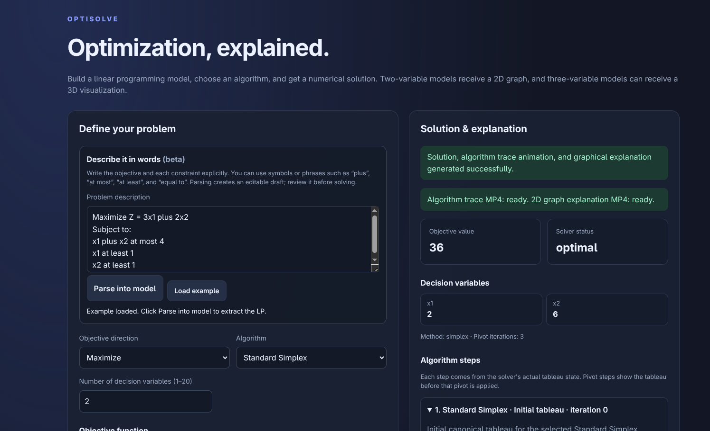
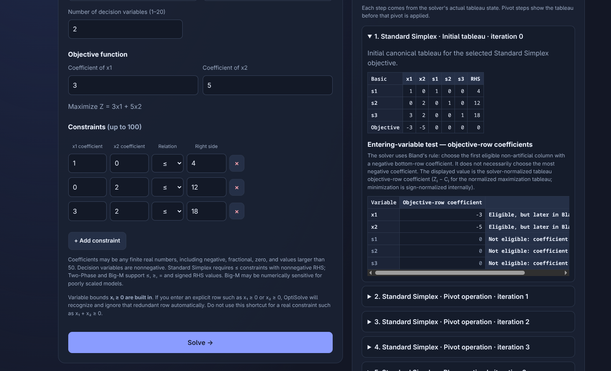
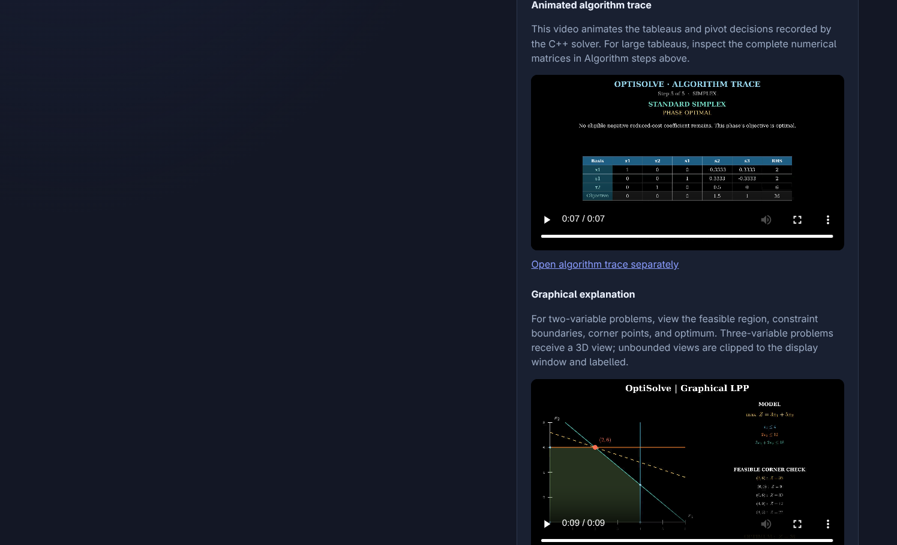
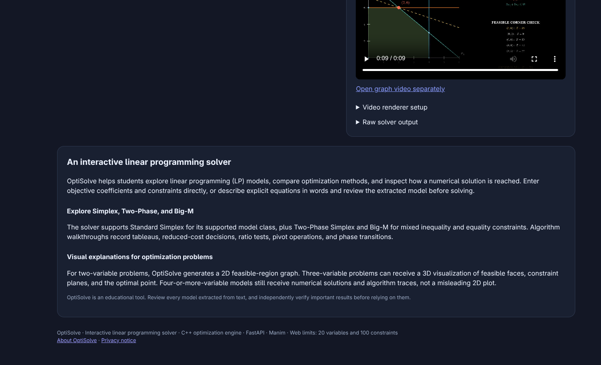
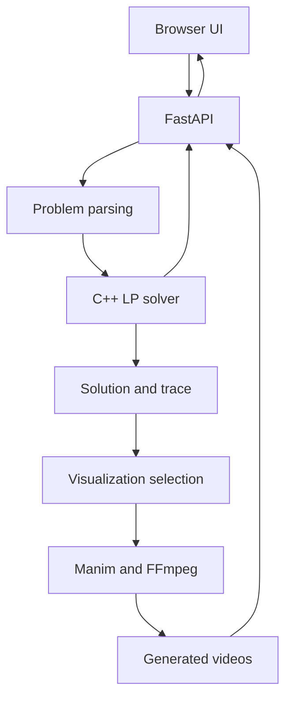

# OptiSolve

**An interactive linear programming solver built to make optimization easier to inspect and understand.**

OptiSolve combines a C++ optimization engine, a FastAPI backend, a browser interface, and Manim-generated visualizations. It is an educational project focused on solving LP models and inspecting how the result is obtained.

**Status:** Runs locally · Docker-supported · No public hosted instance yet

## Screenshots

<p align="center">
  
  
</p>
<p align="center">
  
  
</p>

## Features

- **Optimization:** Standard Simplex, Two-Phase Simplex, and Big-M methods.
- **Model extraction:** Formula-oriented natural-language parsing, with optional LLM-assisted extraction and an editable model for review.
- **Inspectable solving:** Solver results and available algorithm traces.
- **Visual explanations:** 2D graphs for two-variable problems, 3D feasible-region views for three variables, and variable profiles plus constraint diagnostics for higher dimensions.
- **Rendered output:** Manim and FFmpeg-generated graph and algorithm-trace videos.
- **Application integration:** FastAPI endpoints, per-solve workspaces, job-specific video URLs, automated tests, and Docker support.

The web interface is designed for problems with up to 20 decision variables and 100 constraints.

## Architecture



**Stack:** C++17 · Python · FastAPI · HTML/CSS/JavaScript · Manim · FFmpeg · Docker

The optional LLM integration helps extract a mathematical model from text; the C++ solver performs the optimization.

## Run locally with Docker

**Prerequisites:** Docker Engine and Docker Compose.

If you don't already have a local environment file, create one:

```bash
cp .env.example .env
```

For local HTTP access, set these values in `.env` (preserve any other required settings):

```dotenv
DOMAIN=:80
OPTISOLVE_BASE_URL=http://localhost
OPTISOLVE_VIDEO_QUALITY=medium
```

Build and start the services:

```bash
docker compose up -d --build
curl -fsS http://localhost/healthz
```

Open <http://localhost>. Stop the services with `docker compose down`.

## Tests

Run the automated test suite:

```bash
./.venv/bin/python -m pytest -q tests/
```

With the Docker app running, test the real parsing-to-rendering workflow:

```bash
./.venv/bin/python scripts/e2e_smoke_v14.py http://localhost
```

The end-to-end test exercises the actual C++ solver, Manim rendering, and MP4 delivery rather than relying only on mocked API responses.

## Why not just use an LLM?

An LLM can explain or solve many small LP problems. OptiSolve's focus is a dedicated, repeatable workflow: structured model extraction, an implemented numerical solver, inspectable solver traces, and visualizations generated from the computation. It is not intended to outperform general-purpose LLMs at conversational reasoning, and the LLM integration is optional.

## Limitations

- The app currently runs locally; it is not publicly hosted.
- Solving and video rendering are synchronous and resource-intensive.
- Generated outputs are temporary and may be removed by cleanup policies.
- Natural-language parsing expects explicit mathematical relationships, not arbitrary business narratives.
- The app has not been validated for production-scale traffic. Big-M can be numerically sensitive, so compare with Two-Phase Simplex for difficult models.

## Further documentation

- [Architecture](docs/ARCHITECTURE.md)
- [Solver correctness notes](README_SOLVER_CORRECTNESS_V10.md)
- [Visualization notes](README_VISUALIZER_V11.md)
- [Natural-language parsing notes](README_NATURAL_LANGUAGE_V13.md)
